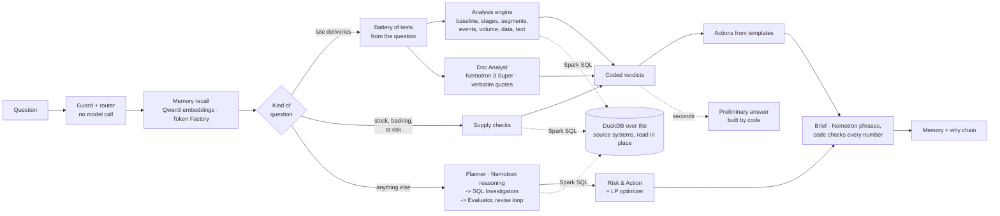

# WhyChain

[](https://github.com/Dakshhhhh-ops/whychain-nebius/actions/workflows/tests.yml)

**WhyChain is an agent that explains *why* a supply-chain problem happened: each cause with its share of the problem, the red herrings it ruled out, and what to do, in money. Every number traces back to the query behind it. Every model call runs on NVIDIA Nemotron, served by Nebius Token Factory.**

Nebius x NVIDIA Global AI Hackathon · Track: **Best Apps and Agents** · **Live demo: [DEMO URL]** · **Demo video: [VIDEO LINK]**


**Why it matters.** When deliveries go late, the answer is spread across the order system, seller exports, customer reviews and the news of the day. An analyst needs half a day to stitch it together; WhyChain does it in minutes and shows its working.

**The result on real data** (Olist, 99,441 real Brazilian marketplace orders), re-measured on Nebius Token Factory on 30 Oct 2026: orders placed in March 2018 were **19.0% late against a normal 5.6%**. Carrier transit explains **72.7%** of the rise and shorter delivery promises **26.7%**. The Correios strike that month is **ruled out**: transit was already 14.1 days before it began, against a normal 8.7. The 1,328 late orders were worth **R$ 187,138**, and their customers rated them **2.1 stars against 4.2** for the orders that arrived on time. Every confirmed cause, share and ruled-out cause is identical to the run recorded on the project's first, NVIDIA NIM version ([run on Token Factory](runs/20261030-060526-66f1/brief.md), [earlier run on NIM](runs/20261028-004653-0e90/brief.md)).

### How WhyChain uses NVIDIA Nemotron and Nebius

| What | Model or service | Its job, and why this choice |
|---|---|---|
| Fast agent work: Document Analyst, Data Scout, SQL investigators, Risk & Action, the brief's short answer | **Nemotron 3 Super** (`nvidia/nemotron-3-super-120b-a12b`) on **Nebius Token Factory**, reasoning off, JSON mode | Reads the written record and quotes it verbatim, maps the data, writes and repairs SQL, phrases the answer from computed facts. Median 1.1 s on a document-reading probe; as accurate as Lightning, Nano and Ultra with reasoning off (measurements below) |
| Planning, judging and writing in the open-ended agent loop | **Nemotron 3 Super**, reasoning on (`chat_template_kwargs.enable_thinking=true`) | Sets competing hypotheses and challenges findings. On the probe, reasoning on was the only setting to score 4/4 (3/4 without), at about 4 s per call |
| Backup when the main model fails or is overloaded | **Nemotron 3 Ultra** (`nvidia/Nemotron-3-Ultra-550b-a55b`) on Token Factory | A different model on the same endpoint takes over any role; every fallback is in the trace |
| Memory recall | **Qwen3-Embedding-8B** on Token Factory (1,024 of its 4,096 dimensions) | Token Factory serves no Nemotron embedder, so memories and recall queries are embedded with its only embedding model; recall is by meaning, not shared words |
| Hosting | **Nebius AI Cloud: Serverless Endpoint** from an image in **Nebius Container Registry** | One CPU container serves the app and API; the models stay on Token Factory. Keyless by default (replays recorded investigations), live with a key behind an access code and daily caps ([deploy/](deploy/nebius-deploy.sh)) |

Nemotron reads, plans, quotes and writes; it never produces a number or a verdict. Those come from code and are checked against the cells they came from, so a late-delivery investigation needs only 5 to 9 model calls (about 15,000 to 40,000 tokens) and gives the same numbers on every run.

### Quick start (about 10 minutes; Python 3.12 or 3.13, Node 20+)

```bash
python3.12 -m venv .venv && source .venv/bin/activate && pip install -e ".[dev]"   # Windows: py -3.12 -m venv .venv; .venv\Scripts\activate; pip install -e ".[dev]"
cp .env.example .env                                              # set NEBIUS_API_KEY (Token Factory)
python -m datagen.olist --no-postgres && python -m datagen.generate && (cd frontend && npm ci && npm run build) && python -m whychain.api
```

Open http://localhost:8000 and click **March 2018 delay spike**. Or with Docker only: `docker build -t whychain . && docker run -p 8000:8000 -e NEBIUS_API_KEY whychain`.

**See a finished investigation without a key:** read the sample briefs on GitHub: [March 2018 on Token Factory](runs/20261030-060526-66f1/brief.md), and two earlier runs, [March 2018](runs/20261028-004653-0e90/brief.md) and [Pune orders at risk](runs/20261027-022755-6d02/brief.md). The app replays any of them with no key: `http://localhost:8000/runs/20261030-060526-66f1?replay=1`.

### Screenshots

| Control tower | A preliminary answer in seconds | The brief: in short, in money |
|---|---|---|
|  |  |  |
| **Every number opens its evidence and SQL** | **A proven-optimal fix, sized from the data** | **Memory with provenance** |
|  |  |  |
| **The why chain** | **Ask why next: one click deeper (Rio de Janeiro)** | **Memory page** |
|  |  |  |

The screenshots are from an earlier build; the screens are the same, and some labels have since changed.

### Contents

[The problem](#the-problem) · [How it works](#how-it-works) · [Nemotron on Token Factory](#nvidia-nemotron-on-nebius-token-factory) · [Hosting on Nebius AI Cloud](#hosting-on-nebius-ai-cloud) · [Tech stack](#tech-stack) · [Setup](#setup) · [Usage](#usage) · [The data](#the-data) · [Results](#results) · [Reliability](#reliability) · [Known limitations](#known-limitations) · [Repository layout](#repository-layout)

## The problem

**On real data.** In March 2018, 19.0% of orders on Olist, a Brazilian marketplace, arrived after the promised date, against about 4–6% in a normal month. The order system shows that it happened, but not why. The evidence is spread across order timestamps, seller hand-over records, customer reviews and the news of the time.

What the raw data shows, checked independently with SQL (not by the agents):
- **Transit:** carrier transit was about 13 days in February–March 2018, against about 8.5 in a normal month. Hand-over by sellers did not slow.
- **Rio de Janeiro:** worst hit. Transit doubled (9.7 → 20.7 days) and late deliveries rose from 6% to 34%, against 16.8% in the rest of Brazil.
- **The 12–13 March Correios strike:** lateness was already high before it.

**In a simulated company,** where the agents can also act on stock: a planner sees that 23 of the 29 open Pune orders due next week have a line on backorder. The answer to "why?" is spread across five systems and three inboxes: the ERP shows the backorders; the warehouse export shows the Pune DC running dry while Mumbai has surplus; the procurement export shows the supplier's revised ETA; the supplier's email explains the delay (a Chennai port strike); the contract says the strike is force majeure; the key customer's contract says every late day costs 1.5% of order value.

## How it works

WhyChain splits the work between **code that computes** and **agents that plan, read and write**. Numbers and verdicts come from code; language models never produce a number that reaches the brief.

**Routing and guard.** Every question first meets WhyChain's router (`whychain/scout.py`): an injection guard refuses instructions aimed at the agents (instruction overrides, mode switches, role markers, requests for secrets) before any model is called, then word rules send the question to the analysis engine (late deliveries), the supply engine (stock and backorders) or the open-ended agent loop. Questions about nothing in the data are answered at once, with no model call.

**Questions about late deliveries** run on the **analysis engine** (`whychain/analysis/`):

1. **One federated query** pulls order-level facts through the data harness: one row per order (purchase, hand-over to the carrier, delivery, promised date, place, seller, carrier). "Late" has one definition: delivered on a later calendar date than promised.
2. **The question becomes a fixed battery of tests** (`battery.py`). The period, places and named events are read from the question with plain rules, and the same kind of question always gets the same tests:
   - **the symptom** against a *normal* baseline (the months before, minus any that were themselves abnormal), and **the value at stake** (what the late orders were worth, and how their customers rated them);
   - **each delivery stage** (seller hand-over, carrier transit, the promise): counterfactual late rates where a stage takes its baseline distribution, matched like with like by area. Exact **Shapley values** split the rise, so the shares add up;
   - **waiting for stock** (datasets with stock data), **where it sits** (a shift-share split by area, seller state or carrier), **volume** against the four weeks before;
   - **dated events** in or near the period: weekly transit and lateness by the week parcels were handed to the carrier, against the **prior trend**. An event counts only if the change starts with it;
   - **data quality**, **what customers wrote**, and for regional questions a comparison with places at a similar distance.
3. **Coded verdicts.** A stage is a cause if it explains at least 10% of the rise **and** the stage itself moved the late way. An event is a cause only if the effect starts with it. The thresholds are in the code and the brief.
4. **Agents** around the engine, all on Nemotron 3 Super on Token Factory: the **Document Analyst** reads the written record and must quote it verbatim (documents are context, never a cause); **actions** come from templates per confirmed cause, sized with computed tables; a model writes only the brief's short answer, from the computed facts, and every number in the brief is checked against its cells.

The computed tests take seconds, so WhyChain publishes a **preliminary answer** built by code while the Document Analyst reads and the model writes.

**Stock-outs, backlogs and orders at risk** (the simulated company) run on the **supply engine** (`whychain/analysis/supply.py`), built the same way: inbound supply against port status, demand against the reorder baseline, reorder policy, duplicate orders and order volume. Actions come from the same numbers, including a **proven-optimal stock-transfer plan**: a transportation linear program solved with OR-Tools and certified by a duality check (`whychain/optimize.py`).

**Any other question** uses the **agent loop** (LangGraph): the Data Scout maps and join-tests the sources; the Planner sets competing hypotheses (Nemotron with reasoning on); Data Investigators write SQL; the Evaluator re-runs every cited query and challenges the reasoning, sending gaps back for another round; Risk & Action calls the optimizer; the Action Executor prepares transfer orders and draft emails after a manager approves.

**Memory and the why chain.** Both paths write confirmed and ruled-out causes, with provenance (run, agent, query or document), to WhyChain's memory (`whychain/memory.py`). Recall ranks memories by meaning with **Qwen3-Embedding-8B on Token Factory**; findings are reused only when they come from a similar question, and never as evidence. A finding another investigation reaches too is promoted to long-term memory with the corroborating runs in its provenance. The why chain (causes with their shares, what explains them, where the problem sits, what was ruled out) is written as relations to the run's own event trace, which the app folds into the cause graph it draws.



## NVIDIA Nemotron on Nebius Token Factory

Every language-model call goes through one OpenAI-compatible client (`whychain/llm.py`) pointed at Token Factory (`https://api.tokenfactory.us-central1.nebius.com/v1/`, key `NEBIUS_API_KEY`). Agents ask for a role, not a model:

| Role | Used by | Chain on Token Factory |
|---|---|---|
| `reason` | Planner, Evaluator | Nemotron 3 Super (reasoning on) → Nemotron 3 Ultra → Nemotron 3 Super |
| `work` | Data Scout, Data Investigators, Risk & Action, Reporter, Action Executor | Nemotron 3 Super (reasoning off) → Nemotron 3 Ultra → Nemotron 3 Super (reasoning on) |
| `local` | Document Analyst | Nemotron 3 Super (reasoning off) → Nemotron 3 Ultra |

Transient errors (5xx, rate limits, timeouts) are retried with back-off, then the next model takes over; the trace records every retry and fallback. Optional providers (NVIDIA NIM with `NVIDIA_API_KEY`, xAI, a local Ollama or Meterless Nightshift model) join the end of a chain only when configured; none is configured in any result reported here.

**How the models were chosen (measured on Token Factory, 30 Oct 2026).** A probe modelled on the Document Analyst's job: four dated documents, three candidate causes for the March 2018 rise, JSON out; scored on whether it supports the two real causes and rules out the strike (4 points). Three calls per setting:

| Model on Token Factory | Reasoning | Median latency | Score (of 4) |
|---|---|---|---|
| `nvidia/nemotron-3-super-120b-a12b` | off | 1.1 s | 3, 3, 3 |
| `nvidia/Nemotron-3_5-Lightning` | off | 1.2 s | 3, 3, 3 |
| `nvidia/NVIDIA-Nemotron-3-Nano-30B-A3B` | off | 1.3 s | 3, 3, 3 |
| `nvidia/Nemotron-3-Ultra-550b-a55b` | off | 0.9 s | 3, 3, 3 |
| `nvidia/nemotron-3-super-120b-a12b` | **on** | 4.3 s | **4, 4, 4** |

With reasoning off the four models were equally accurate, and Lightning and Nano were no faster than Super, so Super is the workhorse (one model family for every role keeps behaviour consistent) and Ultra, the fastest here, is the backup. Reasoning on is reserved for the roles that judge. In the end-to-end March 2018 run all five model calls went to Nemotron 3 Super (reasoning off), median 1.9 s each, 15,191 tokens in all.

**Embeddings.** Token Factory serves one embedding model, `Qwen/Qwen3-Embedding-8B`. WhyChain asks for 1,024 dimensions (the model is Matryoshka-trained; 4,096 is its default), prefixes recall queries with a retrieval instruction as Qwen3 recommends, and embeds new memories in one batched call per run: single-text calls took 1 to 12 s in our measurements, a batch of 20 about 6 s.

## Hosting on Nebius AI Cloud

The [Dockerfile](Dockerfile) builds one image with the web app, the API and both datasets (the Olist data is downloaded and rebuilt during the build). It runs as a **Nebius Serverless Endpoint** from **Nebius Container Registry** on a CPU preset: the models run on Token Factory, not in the container.

- **Without a key** (the default) the app is fully browsable and replays every recorded investigation step by step. Nothing can spend credits.
- **With `NEBIUS_API_KEY`** it runs live investigations. A public URL should also set `WHYCHAIN_ACCESS_CODE` (live runs and approvals ask for it; replays stay open), `WHYCHAIN_MAX_RUNS_PER_DAY` and `WHYCHAIN_DAILY_TOKEN_BUDGET` (an investigation uses about 15,000 to 40,000 tokens). `/api/health` reports the limits.

`deploy/nebius-deploy.sh` does the whole flow: create the registry (once), build for linux/amd64, log in with an IAM token, push, `nebius ai endpoint create` with the container port, then wait for the public URL and check `/api/health`. Locally: `docker build -t whychain . && docker run -p 8000:8000 whychain`.

## Tech stack

| Layer | Technology |
|---|---|
| Models | **NVIDIA Nemotron 3 Super and Nemotron 3 Ultra on Nebius Token Factory** (OpenAI-compatible API: JSON mode, reasoning switch); Qwen3-Embedding-8B on Token Factory for memory recall |
| Hosting | **Nebius AI Cloud** Serverless Endpoint, image in **Nebius Container Registry** |
| Agents and orchestration | Python 3.12/3.13, LangGraph (parallel fan-out per task, bounded revise loop), one OpenAI client with role-based fallback chains, retries and per-endpoint concurrency slots |
| Analysis | pandas; counterfactual late rates per delivery stage, exact Shapley attribution, shift-share decomposition, event tests against the prior trend, coded verdict rules |
| Data | DuckDB querying CSV and JSON exports in place (and Postgres when it runs), with sqlglot translating the agents' Spark SQL |
| Optimization | Transportation linear program; OR-Tools GLOP with COIN-OR CLP as the second solver; duality certificate |
| Memory, routing, why chain | WhyChain's own (Python): JSON memory with provenance and Qwen3 recall, an injection guard and word-rule router, the why chain folded from each run's event trace |
| API and frontend | FastAPI with Server-Sent Events; React 19, TypeScript, Vite, Tailwind CSS 4 |
| Quality | pytest (67 tests, no API keys), ruff, GitHub Actions |

## Setup

**Needs:** Python 3.12 or 3.13 (not 3.14), Node 20+, internet access (the Olist data downloads from a public mirror), and a Nebius Token Factory key (`NEBIUS_API_KEY`). No Docker needed.

```bash
py -3.12 -m venv .venv && .venv/Scripts/python -m pip install -e ".[dev]"   # macOS/Linux: python3.12 -m venv .venv && .venv/bin/pip install -e ".[dev]"
cp .env.example .env                                    # set NEBIUS_API_KEY
.venv/Scripts/python -m datagen.olist --no-postgres     # real Olist data from CSV, a few minutes
.venv/Scripts/python -m datagen.generate                # the simulated company (seconds)
cd frontend && npm ci && npm run build && cd ..
.venv/Scripts/python -m whychain.api                    # http://localhost:8000
.venv/Scripts/python -m whychain.doctor                 # checks data, memory and every model on Token Factory
```

`start.cmd` (Windows) and `./start.sh` (macOS, Linux) start the app and warm it up. **What works without what:** without a key, late-delivery and supply investigations still compute every finding and the brief's short answer is written by code (open-ended questions need a model), recall falls back to keyword overlap, and every recorded run replays. Optional: the Olist order system in Postgres (`docker compose up -d`, `python -m datagen.olist` without `--no-postgres`, `USE_POSTGRES=true`), which DuckDB then reads live.

## Usage

```bash
python -m whychain.api                           # web app + API on http://localhost:8000
cd frontend && npm run dev                       # frontend with hot reload on :5173 (proxies /api)
python -m whychain.cli "Why did late deliveries jump to 19% for orders placed in March 2018?"
python -m whychain.cli --dataset kaveri "Why have deliveries to Nashik been late since September?"
python -m evals.run_evals --dataset olist        # score the real-data cases (or --dataset kaveri, or all)
python -m pytest -q tests                        # the test suite (no API keys needed)
```

| Screen | What it shows |
|---|---|
| **Control tower** | Real data: monthly orders and late deliveries with verified external events marked, KPI cards, incidents found by plain SQL rules, each with **Investigate why**. Simulated company: live KPIs, a Needs attention list and the supply network. |
| **Investigation (live)** | Agents stream their work (Server-Sent Events): Recall → Map data → Plan → Investigate → Challenge → Act → Report, with every query, document read, re-verification and escalation. |
| **Brief** | The answer with clickable evidence behind every number; actions with approve/reject (decisions go to memory); risks; lessons. Export to Markdown or PDF. |
| **Evidence, Memory & graph, Trace** | Every SQL result and verified quote; what was recalled and the run's cause graph; every event, downloadable as JSONL. Any finished run can be replayed. |
| **Memory, Data sources, Regions, Network** | Everything learned across runs; the federated sources and verified joins; a tile map of Brazil's states; the supply network with the cause's path lit up. |

Every run writes `runs/<run_id>/`: `trace.jsonl` (every step, query, model call, fallback, verdict), `result.json` and `brief.md`.

## The data

**Olist (real, default).** The [Brazilian E-Commerce Public Dataset by Olist](https://www.kaggle.com/datasets/olistbr/brazilian-ecommerce) (CC BY-NC-SA 4.0): 99,441 real, anonymised orders from 2016 to 2018. `python -m datagen.olist` downloads the CSVs and splits them into the systems a marketplace actually runs, so the agents have to federate: `oms` (orders, customers), `sellers` (order items with shipping deadlines, sellers, products), `payments`, `feedback` (100,000 real reviews in Portuguese), `signals` (16 verified external events, 2017–2018) and `docs` (13 news briefs on them). Nothing is planted: the events (Correios strikes, the 2018 truckers' strike, Carnival, Black Friday, Rio de Janeiro's security crisis, Correios price changes) were researched from public sources, mainly Agência Brasil, and each lists its source URLs. The dataset is not redistributed in this repository.

**Kaveri (simulated), for the full prescriptive loop.** Olist has no warehouse stock to move, so the optimizer and stock-transfer deliverables are shown on a fictional distributor (3 DCs, 11 suppliers, 74 SKUs, 52 customers; 90 days simulated day by day by `datagen/generate.py`). Problems are planted as causes, not answers, each with a red herring (a port strike stranding a supplier's POs; a carrier's consolidated milk-run; an unshared promotion; an EDI bug duplicating orders). `evals/cases.yaml` holds the ground truth; the agents never see it.

## Results

**Re-measured on Nebius Token Factory (30 Oct 2026, local DuckDB harness, WhyChain's own memory):**

| Question | Result on Token Factory | Same as the NIM version? | Model calls | Run |
|---|---|---|---|---|
| Why did late deliveries jump to 19% for orders placed in March 2018? | 19.0% late vs 5.6%. **Carrier transit 72.7%**, **shorter promises 26.7%** of the rise. Correios strike, Carnival, the Rio storm, a volume surge, seller hand-over and data artefacts **ruled out**. R$ 187,138 at stake. | Yes: all 14 verdicts and both shares identical to `20261028-004653-0e90` | 5, all Nemotron 3 Super; 15,191 tokens; no fallbacks | [`20261030-060526-66f1`](runs/20261030-060526-66f1/brief.md) |

**All 18 eval questions on Token Factory (30 Oct 2026):** root cause found in **18 of 18**, red herring avoided in **15 of 15**, right action in **8 of 8**, held-out questions **4 of 4**: the same score as an earlier final pass on NVIDIA NIM (23 Oct), with every headline's first sentence identical to that pass. 105 model calls (4 to 8 per question, 104 on Nemotron 3 Super, one fallback to Ultra), 392,006 tokens in all. All ground truth was written by the author (the simulated company's causes were planted), so these are development checks, not independent validation. Question by question: [docs/RESULTS.md](docs/RESULTS.md).

The numbers are computed by code, not the model, which is why the answers did not change when the models moved from NIM's Nemotron 3.5 Super to Nemotron 3 Super on Token Factory.

## Reliability

| Safeguard | What it prevents |
|---|---|
| Read-only SQL guard; SQL self-repair loop; evidence re-execution | Agents changing data; failed queries stopping a task; cited results that aren't the real output of their query |
| Numbers check (`whychain/grounding.py`) | Numbers no cited cell supports: findings, action figures and every line of the brief are checked cell by cell (on a probe of 1,000 fabricated numbers, 3% pass) |
| Verbatim quote verification; citation filter; join tests | Invented quotes; citations to evidence that doesn't exist; bad joins |
| Question-similarity filter on memory | Findings from an unrelated investigation being reused |
| Model fallback chain (Super → Ultra on Token Factory) | One model failing the whole run (both sit on the same Token Factory endpoint, so not an endpoint outage) |
| Injection guard; off-topic check | Instructions hidden in a question reaching the agents; a question about nothing in the data starting an investigation. Both answered with no model call |
| Access code, run and token caps on a public URL | Anyone draining Token Factory credits through the demo |
| Bounded rounds; run time limit; deterministic escalation thresholds | Endless revise loops; hung runs; expensive actions going ahead without a human |

## Known limitations

| Limitation | Where it stands |
|---|---|
| The eval set is small and self-written. | 18 questions (4 held out), all ground truth written by the author. All 18 pass on Token Factory as on NIM; the open-ended agent loop (questions outside both engines) has no eval case of its own. |
| Fallback stays on one endpoint. | Nemotron 3 Super and Ultra are both on Token Factory; an outage of the endpoint stops model calls (the computed findings and preliminary answer still appear). NIM can be added behind it with `NVIDIA_API_KEY`. |
| Embedding latency. | Qwen3-Embedding-8B calls on Token Factory took 1 to 12 s; WhyChain batches memory writes into one call per run and recall into one query call. |
| Results vary in the agent loop. | Late-delivery and supply questions give the same computed findings every run; only the Document Analyst's reading and the short written answer vary. Open-ended questions run models at temperature 0.2. |
| The engine's choices are judgement calls. | The 10% cause threshold, the stage-must-move rule, the abnormal-month rule and the event thresholds were chosen by the author; they are fixed and tested (`tests/test_analysis.py`) but not validated against outside data. |
| No cost data on the real dataset. | Olist actions show the value at stake, not what the fix would cost; only the simulated dataset has proven-optimal costs. |
| Memory recall is a hint, not evidence. | Findings are reused only from a similar question and never cited. The Document Analyst's one-line summary of the written record can over-reach (it says the Correios strike "affected delivery operations", which the event test rules out as a cause of the rise); it never reaches a verdict. |

## Repository layout

```
whychain/          agents, graph (LangGraph), data harness, LLM client (Token Factory), memory, router, trace, CLI, API
  analysis/        deterministic engine: question -> battery of tests -> findings with coded verdicts
  agents/          prompts, executor (act-observe loop), nodes (each agent)
  grounding.py     numbers check: every number must trace to a cited cell
  optimize.py      prescriptive layer: data -> transportation LP -> solver + duality certificate
frontend/          React + TypeScript + Tailwind web app (Vite)
datagen/           Olist loader, company simulator, documents
evals/             ground-truth cases and scorer
deploy/            Nebius Container Registry + Serverless Endpoint deploy script
runs/              three recorded investigations, replayable without a key
tests/             67 tests with a scripted model (no API keys)
Dockerfile         one image: web app, API and data
meterless_bridge/  optional Meterless engines adapter; not used by default
docs/              results and demo script
```

**Optional integrations**, off by default: NVIDIA NIM (`NVIDIA_API_KEY`), the Zetaris federated data platform (`WHYCHAIN_HARNESS=zetaris`), and the Meterless engines bridge (`METERLESS_BRIDGE_URL`: H-MEM memory, World Model and Scout Intent routing; its embeddings also use Token Factory when `NEBIUS_API_KEY` is set) with Nightshift for reading documents on a local GPU. See `.env.example`.

## Third-party components

- Open-source libraries listed in `pyproject.toml`, `frontend/package.json` and `meterless_bridge/package.json`.
- `meterless_bridge/engines/` (optional adapter): Meterless H-MEM and World Model reference engines, copied from `Meterless/Meterless` @ `1742dec` (Apache-2.0, LICENSE files included); one file (`engines/hmem/reference/src/embeddings.ts`) gained a provider hook, with a notice saying so.
- The Olist dataset is third-party public data (CC BY-NC-SA 4.0), downloaded by `datagen/olist.py` and not included in the repository.

## Development tools

Built with Claude Code in VS Code.
